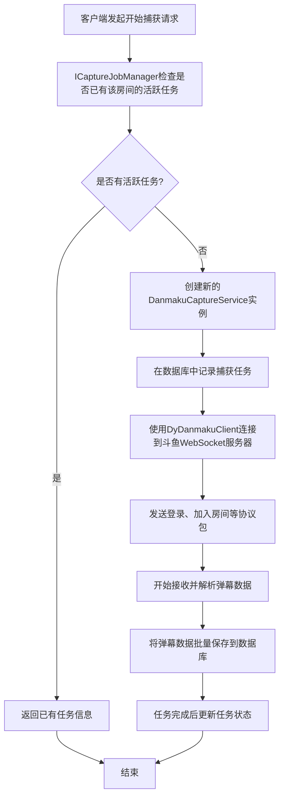
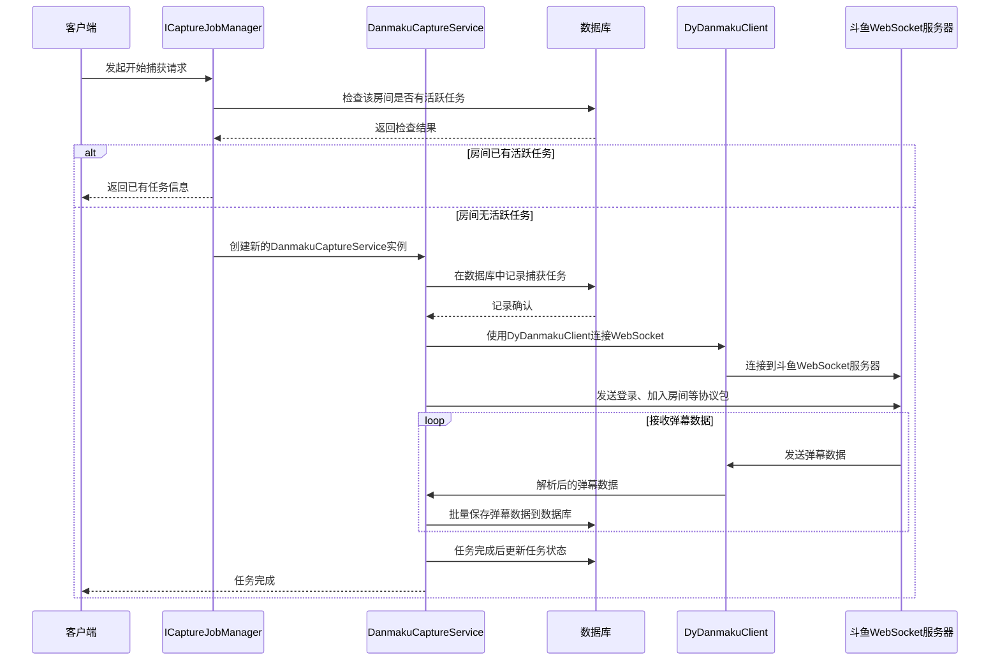

# DyDanmaku.API 功能与业务逻辑总结

根据代码分析，DyDanmaku.API 是一个斗鱼直播平台弹幕捕获、处理和分发的API服务。以下是其主要功能和业务逻辑：

## 主要功能

### 1. 弹幕捕获功能

实时捕获：通过WebSocket连接到斗鱼弹幕服务器，实时捕获指定房间的弹幕  
任务管理：支持启动、停止弹幕捕获任务，并管理任务状态  
房间信息获取：自动获取主播信息并存储到数据库  

### 2. API 接口功能

启动/停止捕获：提供REST API接口用于控制弹幕捕获任务  
数据查询：提供分页查询弹幕、房间、捕获任务等功能  
统计分析：提供弹幕数据分析和词频统计功能  
实时推送：通过SignalR Hub向客户端实时推送新弹幕  

### 3. 后台任务功能

定时任务：按预定时间表自动启动弹幕捕获任务  
监控任务：定期检查过期任务并自动停止  

### 业务逻辑流程

#### 1. 弹幕捕获流程

客户端发起开始捕获请求
ICaptureJobManager 检查是否已有该房间的活跃任务  
创建新的 DanmakuCaptureService 实例  
在数据库中记录捕获任务  
使用 DyDanmakuClient 连接到斗鱼WebSocket服务器  
发送登录、加入房间等协议包  
开始接收并解析弹幕数据  
将弹幕数据批量保存到数据库  
任务完成后更新任务状态  

### 流程图 (TB)

### 时序图

#### 2. 任务管理系统

使用 ConcurrentDictionary 管理活跃任务
通过 IMemoryTaskScheduler 调度长时间运行的捕获任务
任务完成后自动清理资源
提供优雅的启动/停止机制

#### 3. WebSocket通信机制

连接到斗鱼弹幕服务器 (wss://danmuproxy.douyu.com)
使用特定协议格式发送心跳包保持连接
解析二进制格式的弹幕数据包
将接收到的弹幕数据缓存并批量写入数据库

#### 4. 实时推送机制

使用SignalR Hub建立客户端连接
用户可以加入指定房间组
通过 IDanmakuPushService 将新弹幕推送到对应房间的所有连接

#### 5. 定时任务机制

根据配置文件中的时间表自动启动捕获任务
按照预设的房间ID和持续时间进行捕获
支持多个房间的定时捕获任务

#### 6. 任务监控机制

定期检查数据库中过期的捕获任务
自动停止超时的任务
更新任务状态为完成或取消

### 技术特点

异步编程模型：大量使用async/await模式处理网络请求和数据库操作  
依赖注入：使用IServiceProvider管理对象生命周期  
线程安全：使用ConcurrentDictionary等线程安全集合  
资源管理：实现IDisposable接口确保资源正确释放  
事务处理：在数据库操作中使用事务保证数据一致性  
客户端池化：使用Channel实现WebSocket客户端池，提高性能  
错误处理：完善的异常处理和重连机制  

### 数据模型

Danmaku实体：存储捕获的弹幕信息（用户ID、用户名、内容、等级等）  
Room实体：存储房间信息（房间ID、主播名等）  
CaptureJob实体：存储捕获任务信息（状态、开始时间、持续时间等）  

整个系统设计为可扩展的微服务架构，具有高并发处理能力和良好的容错性，能够稳定地捕获和处理斗鱼直播平台的弹幕数据。  