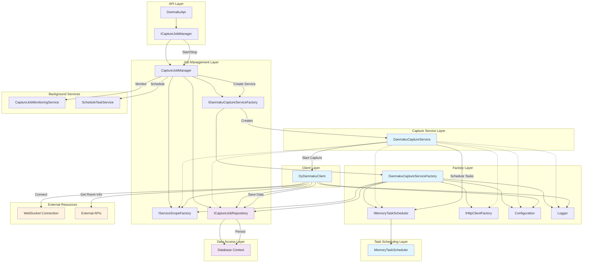

# Architecture Diagram

## Diagram

## 架构说明

### 1. API层

DanmakuApi: REST API入口点，接收启动/停止捕获请求  

### 2. 任务管理层

ICaptureJobManager / CaptureJobManager: 负责管理所有捕获任务，跟踪活跃任务，与数据库交互  

### 3. 工厂层

IDanmakuCaptureServiceFactory / DanmakuCaptureServiceFactory: 负责创建和管理DanmakuCaptureService实例  

### 4. 任务调度层

IMemoryTaskScheduler / MemoryTaskScheduler: 内存任务调度器，管理长时间运行的捕获任务  

### 5. 捕获服务层

DanmakuCaptureService: 核心捕获服务，使用IServiceScopeFactory管理服务生命周期  

### 6. 客户端层

DyDanmakuClient: WebSocket客户端，实际执行弹幕捕获  

### 7. 数据访问层

ICaptureJobRepository: 数据访问接口，管理任务状态持久化  

### 8. 后台服务

CaptureJobMonitoringService: 监控过期任务  
ScheduleTaskService: 定时任务服务  

### 关键特性

服务生命周期管理: 使用IServiceScopeFactory确保每次数据库操作都有独立作用域  

内存任务调度: MemoryTaskScheduler管理长时间运行的任务  

线程安全: 使用ConcurrentDictionary管理任务状态  

优雅取消: 支持CancellationToken的取消机制  

资源清理: 任务完成或取消时自动清理资源  