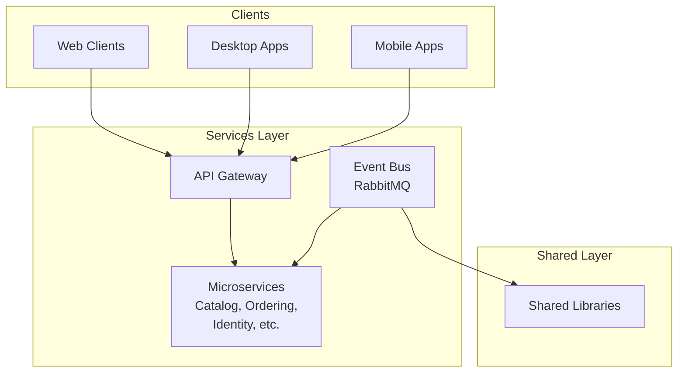

# Aether

Aether is a comprehensive solution showcasing modern C# development practices with a focus on .NET, ASP.NET Core, and various client technologies. This project demonstrates microservices architecture, event-driven systems, desktop applications, and modern web development techniques.

## Table of Contents

- [Aether](#aether)
  - [Table of Contents](#table-of-contents)
  - [Overview](#overview)
  - [Architecture](#architecture)
  - [Key Components](#key-components)
    - [Backend Services](#backend-services)
      - [Ordering.API](#orderingapi)
      - [EventBus / EventBusRabbitMQ](#eventbus--eventbusrabbitmq)
      - [OrderProcessor](#orderprocessor)
    - [Web Applications](#web-applications)
      - [Angular App (bookstore-app)](#angular-app-bookstore-app)
      - [React/Vue Applications](#reactvue-applications)
    - [Infrastructure](#infrastructure)
      - [Aether.AppHost](#aetherapphost)
      - [IntegrationEventLogEF](#integrationeventlogef)
      - [Shared Libraries](#shared-libraries)
    - [DyDanmaku System](#dydanmaku-system)
      - [DyDanmaku.API](#dydanmakuapi)
      - [dydanmaku-analytics](#dydanmaku-analytics)
      - [dydanmaku-viewer](#dydanmaku-viewer)
  - [Technologies Used](#technologies-used)
    - [Backend](#backend)
    - [Frontend](#frontend)
    - [Development Practices](#development-practices)
  - [Getting Started](#getting-started)
    - [Prerequisites](#prerequisites)
    - [Building the Solution](#building-the-solution)
    - [Running Services](#running-services)
    - [Running Frontend Applications](#running-frontend-applications)
  - [Project Structure](#project-structure)
  - [Service Port Allocations](#service-port-allocations)
  - [License](#license)

## Overview

Aether is a multi-module solution that demonstrates various modern software development practices using C# and .NET technologies. The project includes microservices, desktop applications (WPF, WinUI, WinForms), web applications (Angular, React, Vue), and supporting infrastructure components.

The solution showcases:
- Microservices architecture with .NET
- Event-driven systems with RabbitMQ
- Domain-Driven Design (DDD) principles
- Modern web development with various frontend frameworks
- Desktop application development with multiple technologies
- Integration patterns and best practices

## Architecture

The solution follows a microservices architecture with the following key patterns:
- API Gateways
- Event-driven communication via EventBus and RabbitMQ
- Domain-Driven Design for business logic
- Separation of concerns with layered architecture



## Key Components

### Backend Services

#### Ordering.API
Handles order processing with a complete domain model including:
- Ordering.Application (CQRS pattern implementation)
- Ordering.Domain (Domain entities and business logic)
- Ordering.Infrastructure (Data access and external service integrations)


#### EventBus / EventBusRabbitMQ
Event-driven communication infrastructure enabling loose coupling between services.

#### OrderProcessor
Background service for processing orders and handling related events.

### Web Applications

#### Angular App (bookstore-app)
Angular-based frontend application with TypeScript.

#### React/Vue Applications
Modern frontend applications using React and Vue with Vite tooling.

### Infrastructure

#### Aether.AppHost
Orchestration layer for managing multiple services.

#### IntegrationEventLogEF
Entity Framework implementation for integration event logging.

#### Shared Libraries
Common components, utilities, and base classes used across the solution.

### DyDanmaku System

#### DyDanmaku.API
ASP.NET Core Web API service responsible for capturing danmaku messages from Douyu live rooms. Features include:
- Real-time danmaku capture using ASP.NET Core
- SignalR hub for real-time push of danmaku messages
- RESTful API for danmaku CRUD operations
- Integration with PostgreSQL for persistent storage

#### dydanmaku-analytics
Python-based analytics service that performs hourly statistical analysis of danmaku data, including:
- Hourly word frequency analysis
- Generation of word cloud charts using recharts
- Time distribution charts
- Top active users statistics

#### dydanmaku-viewer
React-based frontend application for danmaku management and visualization.

## Technologies Used

### Backend
- .NET 10
- ASP.NET Core
- Entity Framework Core
- SignalR
- RabbitMQ
- PostgreSQL
- OpenAPI/Swagger

### Frontend
- Angular 21
- React (with Vite)
- TypeScript
- AntDesign

### Development Practices
- Domain-Driven Design (DDD)
- CQRS
- Event-Driven Architecture
- Microservices
- Dependency Injection
- Unit Testing

## Getting Started

### Prerequisites
- .NET 10 SDK
- Node.js (for frontend applications)
- PostgreSQL (for database)
- RabbitMQ (for event-driven features)
- Redis (for caching)
- Docker (for containerization)

### Building the Solution

```bash
# Clone the repository
git clone <repository-url>
cd Aether

# Restore NuGet packages
dotnet restore

# Build the solution
dotnet build
```

### Running Services

```bash
# Run a specific service
dotnet run --project src/Catalog.API

# Run with AppHost (if configured)
dotnet run --project src/Aether.AppHost
```

### Running Frontend Applications

```bash
# For Angular app
cd src/bookstore-app
pnpm install
pnpm start

# For React/Vue apps (similar pattern)
cd src/<app-directory>
pnpm install
pnpm run dev
```

## Project Structure

```
Aether/
├── src/
│   ├── Ordering.API/             # Order processing microservice
│   │   ├── Ordering.Application/ # Application logic and CQRS
│   │   ├── Ordering.Domain/      # Domain model and entities
│   │   └── Ordering.Infrastructure/ # Data access and external services
│   ├── Identity.API/             # Authentication service
│   ├── EventBus/                 # Event bus abstraction
│   ├── EventBusRabbitMQ/         # RabbitMQ implementation
│   ├── Aether.AppHost/     # Service orchestration
│   ├── bookstore-app/            # Angular frontend application
│   └── ...                       # Additional services and applications
├── test/
│   └── ...                       # Unit and integration tests
├── Directory.Build.props         # Common build properties
└── Directory.Packages.props      # Central package management
```

## Service Port Allocations

The following table shows the port allocations for services managed by the AppHost:

| Service                      | Https Port | Http Port | Type              |
| ---------------------------- | ---------- | --------- | ----------------- |
| Redis                        | N.A        | 6379      | Database          |
| RabbitMQ                     | N.A        | 5672      | Message Broker    |
| RabbitMQ Management          | N.A        | 15672     | Management UI     |
| PostgresSQL                  | N.A        | 5432      | Database          |
| Keycloak                     | N.A        | 8080      | Identity Provider |
| Ordering API                 | 5005       | 5004      | Backend API       |
| Web App                      | 5009       | 5008      | Frontend          |
| Order Processor              | 5011       | 5010      | Frontend          |
| Bookstore API (Nestjs)       | 3011       |           | Backend API       |
| Bookstore App (Angular)      | 3012       |           | Frontend          |
| dydanmaku-analytics (Python) | 8000       |           | Backend API       |
| dydanmaku-viwer (React)      | 3015       |           | Frontend API      |
| DyDanmaku.API                | 5000       | 5001      | Backend API       |

All backend APIs now have corresponding clients configured in Keycloak with the naming pattern `{service-name}-api` (e.g., `ordering-api`, etc.). Frontend applications use the naming pattern `{service-name}-app` (e.g., `bookstore-app`, etc.).

## License

This project is licensed under the MIT License - see the [LICENSE.txt](LICENSE.txt) file for details.